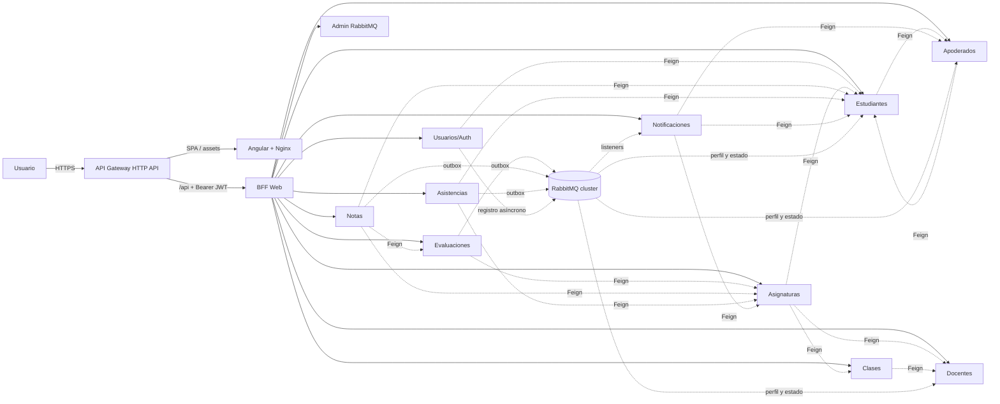

# Arquitectura de SIGA

## Propósito y estado

SIGA es un sistema de gestión académica con SPA Angular, BFF Spring Boot y microservicios por dominio. Los servicios REST usan OAuth2/JWT de Microsoft Entra ID; los datos se separan lógicamente por servicio con MariaDB/Flyway. RabbitMQ desacopla registro de perfiles y notificaciones académicas.

El repositorio incluye 11 microservicios, BFF, frontend, biblioteca `core-share` e infraestructura. Las pantallas Angular tienen integración real con el BFF para los recursos con contrato; `useMocks=false` es el default, y los errores HTTP no cambian silenciosamente a mocks. Hay recursos y vistas que aún dependen de demo/constants o no tienen endpoint. Ver el detalle actual en [`frontend.md`](frontend.md) y las fichas de [`microservicios/`](microservicios/README.md).

> Esta página describe arquitectura en código. “Desplegado” o “activo” debe corroborarse en AWS/Entra en la fecha de uso. La bitácora [`registro-pruebas.md`](registro-pruebas.md) registra verificaciones pasadas, no salud continua.

## Vista de componentes

Las flechas Feign son HTTP síncrono; las líneas discontinuas hacia RabbitMQ son mensajería asíncrona. El [catálogo de microservicios](microservicios/README.md) especifica cada dependencia y motivo.

## Fronteras y persistencia

- **Frontend:** Angular/Nx implementa portales público, estudiante, apoderado, docente y administrador. Solo se comunica con `/api` del BFF.
- **BFF:** puerta de entrada, autorización por operación y composición de vistas/consultas. No posee BD de dominio.
- **Microservicios:** 11 componentes Spring Boot que poseen su modelo y API. Usuarios, estudiantes, apoderados, docentes, asignaturas, clases, evaluaciones, notas, asistencias y notificaciones son dominios separados; Rabbit admin no persiste datos de negocio.
- **`core-share`:** contratos y capacidades transversales; no contiene entidades de dominio.
- **Database-per-service:** en Compose local hay una MariaDB por servicio con persistencia propia; en la plantilla AWS se usa un contenedor MariaDB con diez bases separadas. La separación lógica de bases se mantiene, pero el motor físico en AWS es compartido.
- Flyway crea/evoluciona esquemas; Hibernate valida (`ddl-auto=validate`). Los servicios no deben leer las tablas de otro dominio.

## Flujo HTTP y seguridad

1. Angular carga configuración runtime y autentica con MSAL contra Entra ID.
2. El cliente adjunta access token Bearer a solicitudes `/api`.
3. API Gateway valida JWT para `ANY /api/{proxy+}` y enruta al BFF.
4. BFF y microservicios vuelven a validar JWT (defensa en profundidad); controles de rol/scope se ejecutan en backend.
5. BFF llama al dueño del recurso por Feign, propagando `Authorization` y correlation ID cuando corresponda.
6. El servicio valida entrada/reglas del dominio, persiste con su repositorio y responde DTO.

El JWT Authorizer usa issuer/audience del token efectivo de Entra. `core-share/JwtResourceServerConfiguration` configura el `NimbusJwtDecoder` compartido: valida firma mediante JWKS, issuer, expiración y audience; `JwtClaimAuthoritiesConverter` mapea `scp → SCOPE_` y `roles → ROLE_`. `AZURE_JWT_ISSUER`, `AZURE_JWKS_URI` y `AZURE_JWT_AUDIENCES` permiten override no secreto; los defaults reflejan el issuer v1 registrado en la bitácora. `SharedSecurityConfig` aplica Resource Server stateless y `@PreAuthorize`. `OPTIONS` se permite para preflight; documentación técnica y health son rutas públicas explícitas. Guards Angular comparan claims para navegación, pero no reemplazan autorización de servidor.

## Mensajería desacoplada

### Registro asíncrono

`ms-usuarios-auth` guarda proceso/outbox en la misma transacción y publica la etapa de aprovisionamiento a `user.topic.exchange`. Tras resolver cuenta/rol en Entra ID, enruta perfil a `ms-estudiantes`, `ms-docentes` o `ms-apoderados`. Cada perfil procesa idempotentemente y publica resultado a la cola de estado. La topología se declara en `core-share/RegistrationMessagingConfig` bajo property para los servicios participantes. El flujo asíncrono es opcional (`REGISTRO_ASYNC_ENABLED`, default `false`); el alta administrativa requerida por EP1 no depende de activar esta opción.

### Notificaciones académicas

`ms-evaluaciones`, `ms-notas` y `ms-asistencias` guardan eventos en outbox de dominio. El dispatcher publica con confirms; un exchange topic los enruta a tres colas de `ms-notificaciones`, una por tipo. Consumidores deduplican/persisten y mantienen estados de lectura por OID. Rechazos van al direct exchange `siga.dlx.direct` y DLQ correspondiente.

Ambos flujos usan ACK manual, reintentos acotados y logs/correlation ID compartidos, pero sus contratos/consumidores son distintos. El correo externo no forma parte del canal académico actual.

## Despliegue

- **Local:** `docker-compose.yml` define 10 MariaDB, 11 microservicios, BFF, frontend y dos nodos RabbitMQ. La UI RabbitMQ se publica localmente en 15672 desde `rabbitmq1`.
- **AWS Academy:** Terraform crea VPC/subnet pública, EC2 `t3.large`, EIP, EBS, ECR y API Gateway HTTP API. Una sola EC2 corre el stack Compose, incluidos ambos nodos RabbitMQ; los dos nodos comparten el mismo host/failure domain y no equivalen a alta disponibilidad multi-AZ.
- **TLS:** API Gateway da HTTPS al navegador; integración Gateway→EC2 usa HTTP. Caddy publica el Management UI RabbitMQ por HTTPS con autenticación del propio broker.
- **Persistencia/respaldo:** datos MariaDB/RabbitMQ montados en EBS; el workflow CD instala respaldo diario de las diez bases y definiciones de RabbitMQ, con retención configurada. El respaldo depende de la instancia/lab; un reset de Academy puede borrar EBS.
- **CI/CD:** `.github/workflows/ci.yml` ejecuta build/tests backend y typecheck/tests/build frontend en push `dev`, `main`, `deploy` y PR a las tres ramas. `.github/workflows/cd.yml` limita el despliegue a `deploy` y `workflow_dispatch`, y ahora verifica backend/frontend antes del job AWS. Flujo de release: `feature → dev → deploy (AWS + aceptación) → main (mismo SHA)`; para una sincronización documental sin despliegue, CD debe deshabilitarse temporalmente antes del push a `deploy`.

Detalles concretos, variables y operación están en [`../infra/terraform/README.md`](../infra/terraform/README.md), [`testing-login.md`](testing-login.md) y [`backend.md`](backend.md).

## Estado por capacidad

| Capacidad | Estado del código | Evidencia/condición |
|---|---|---|
| Autenticación MSAL + JWT | Angular y resource server/API Gateway configurados | Revisar issuer/audience/scopes efectivos de tenant y tokens reales; ver auditoría EP1 externa. |
| CRUD y dominio académico | Servicios con JPA/Flyway, búsquedas y validación | Endpoints y reglas están en las fichas; revisar CI del commit usado. |
| Integración frontend-BFF | Disponible para varios flujos; no todos los recursos están conectados | Falla de API se muestra como error/vacío con reintento; no implica fallback automático a mocks. |
| Registro asíncrono | Outbox, Graph, colas, listeners por rol y estado del proceso | Hay E2E históricos; Graph depende de permisos/secrets del tenant. |
| Notificaciones in-app | Eventos, outbox, bandeja, lectura por OID, BFF y campana | E2E histórico de ACK/DLQ; correo no incluido. |
| RabbitMQ admin/cluster | API REST admin y configuración de dos nodos | Revalidar cluster/dashboard si se requiere afirmar estado cloud actual. |
| Observabilidad avanzada | Health, correlation ID, OpenAPI | Logs estructurados completos, métricas y tracing quedan pendientes. |

## Documentos canónicos

- Backend global: [`backend.md`](backend.md); detalle por módulo: [`microservicios/README.md`](microservicios/README.md).
- Frontend: [`frontend.md`](frontend.md).
- Infraestructura: [`../infra/terraform/README.md`](../infra/terraform/README.md).
- Autenticación/pruebas: [`testing-login.md`](testing-login.md) y [`registro-pruebas.md`](registro-pruebas.md).
