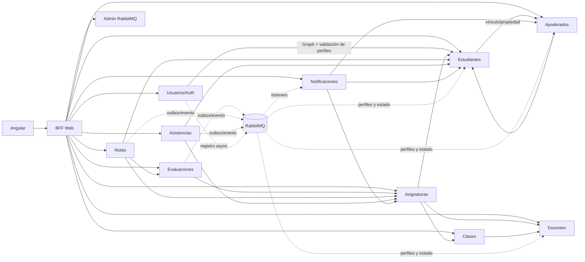

# Catálogo de microservicios y dependencias

Este directorio es la referencia por componente del backend. `docs/backend.md` mantiene el panorama transversal; aquí se describen responsabilidad, dependencias declaradas, patrones y acoplamientos de cada ejecutable. La arquitectura de sistema está en [`docs/arquitectura.md`](../arquitectura.md).

SIGA tiene **11 microservicios de dominio/soporte**, un **BFF Web** y una biblioteca transversal (`core-share`). `ms-auditoria` está comentado en el POM padre, no se cuenta como implementado y tiene reservado el puerto 8082.

## Fichas

| Componente | Puerto | Persistencia propia | Ficha |
|---|---:|---|---|
| BFF Web | 8080 | No | [bff-web.md](bff-web.md) |
| Usuarios y autenticación | 8081 | `siga_usuarios_db` | [ms-usuarios-auth.md](ms-usuarios-auth.md) |
| Estudiantes | 8083 | `siga_estudiantes_db` | [ms-estudiantes.md](ms-estudiantes.md) |
| Apoderados | 8084 | `siga_apoderados_db` | [ms-apoderados.md](ms-apoderados.md) |
| Docentes | 8085 | `siga_docentes_db` | [ms-docentes.md](ms-docentes.md) |
| Asignaturas, horarios e inscripciones | 8086 | `siga_asignaturas_db` | [ms-asignaturas.md](ms-asignaturas.md) |
| Clases | 8087 | `siga_clases_db` | [ms-clases.md](ms-clases.md) |
| Evaluaciones | 8088 | `siga_evaluaciones_db` | [ms-evaluaciones.md](ms-evaluaciones.md) |
| Notas | 8089 | `siga_notas_db` | [ms-notas.md](ms-notas.md) |
| Asistencias | 8090 | `siga_asistencias_db` | [ms-asistencias.md](ms-asistencias.md) |
| Notificaciones | 8091 | `siga_notificaciones_db` | [ms-notificaciones.md](ms-notificaciones.md) |
| Administración RabbitMQ | 8092 | No | [ms-rabbitmq-admin.md](ms-rabbitmq-admin.md) |
| Biblioteca transversal | — | No | [core-share.md](core-share.md) |

## Dependencias entre componentes

Las flechas HTTP representan invocaciones síncronas con OpenFeign; los flujos RabbitMQ son asíncronos y se detallan después. Las direcciones y políticas efectivas están en los clientes `@FeignClient`, `application.yaml` y Compose; si difieren, esas fuentes de ejecución prevalecen sobre este resumen.

### Dos flujos asíncronos distintos

1. **Registro de usuario:** `ms-usuarios-auth` persiste solicitud/proceso/outbox; aprovisiona Entra ID y publica eventos por rol. `ms-estudiantes`, `ms-docentes` y `ms-apoderados` consumen y devuelven estado. Las definiciones viven en `core-share/RegistrationMessagingConfig.java` y se habilitan por propiedad en servicios AMQP participantes.
2. **Notificaciones académicas:** `ms-evaluaciones`, `ms-notas` y `ms-asistencias` escriben outbox transaccional; el dispatcher publica eventos versionados; `ms-notificaciones` consume, deduplica y persiste la bandeja. Topología académica: topic `intercambio-notificaciones`, colas por dominio y DLQ en direct `siga.dlx.direct`.

Ambos flujos usan constantes/configuración compartidas, pero tienen contratos, eventos y consumidores diferentes; no deben documentarse como una única cola de “notificaciones”.

## Dependencias comunes y lectura de POM

El padre [`apps/backend/pom.xml`](../../apps/backend/pom.xml) centraliza Java 21, Spring Boot 3.5.0, Spring Cloud 2025.0.0, Azure Spring 5.18.0, Springdoc 2.8.14, MapStruct 1.5.5 y Lombok/test global. Eso **no** significa que cada módulo incluya todos los starters: cada ficha enumera sus dependencias directas. `core-share` agrega auto-configuración, DTOs, seguridad, validación, AMQP, retry y conversión; cuando un módulo obtiene AMQP vía esa dependencia transitiva, se indica como tal.

Patrones transversales:

- **database-per-service:** las entidades JPA y migraciones Flyway pertenecen al servicio dueño; los demás consultan APIs, no tablas compartidas.
- **Capas REST → service → repository:** los controladores gestionan HTTP/DTO, los servicios las reglas del dominio y los repositorios JPA la persistencia. MapStruct se usa donde el módulo lo declara.
- **OAuth2 Resource Server:** `core-share` configura seguridad stateless y mapeo `scp`/`roles`. Los guards Angular son UX; la autorización efectiva recae en backend.
- **Feign + Resilience4j:** solo donde el módulo declara ambos starters; `SharedFeignAuthConfig` propaga `Authorization` y el correlation ID cuando aplica.
- **Outbox/idempotencia:** evitar perder eventos entre commit de negocio y publicación; consumidores deduplican por identidad del evento o usuario/proceso.

Para contratos HTTP completos y paginación consulte [backend.md](../backend.md) y OpenAPI en `/v3/api-docs`, `/docs/swagger` o `/docs/scalar`. No se repite aquí cada campo de todos los DTOs.
